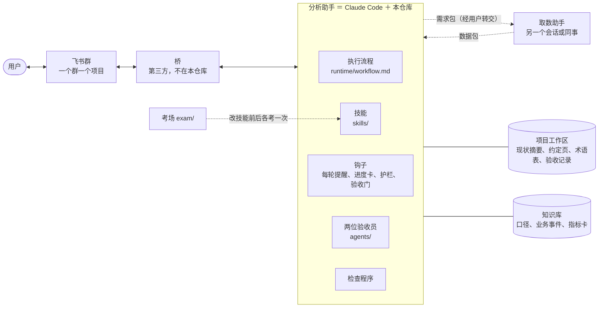
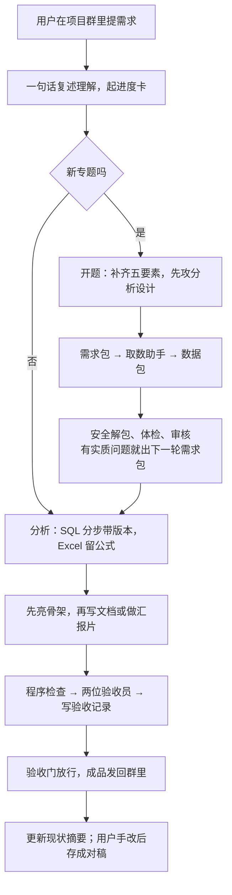

# ai-analyst-workbench · 分析师的 AI 工作台

[](https://github.com/Ethanyang9512/ai-analyst-workbench/actions/workflows/tests.yml)
[](LICENSE)
[](LICENSE-docs)

**English:** see [README.en.md](README.en.md).

**一句话：** 一套给数据分析师用的 Claude Code 技能、钩子和验收员，让 AI 助手帮你写分析报告、做汇报片、审数据包，而且**每个数都能从数据一路复核到图上**。

> 下文的“用户”指使用这套工作台的分析师，也就是你；“分析助手”是在终端或飞书群里干活的 Claude Code。仓库里所有例子都是虚构的。

## 30 秒看效果

不用装任何依赖，在仓库根目录跑：

```bash
python3 skills/report-writing/scripts/style_lint.py exam/example-paper/delivered.md
python3 examples/续费率下滑归因/analysis/recompute.py
```

第一条拿示例报告的初稿查禁用词，真实输出（每行末尾的原文上下文有截短）：

```
== exam/example-paper/delivered.md  硬禁 4 / 警告 0 ==
  [硬禁] L9 「断崖式」→ 下降，并写出幅度   | **结论：续费率从 W5 的 80.8% 断崖式下跌到 W6 的 76.98%……
  [硬禁] L9 「我们认为」→ 数据显示   | ……
  [硬禁] L11 「值得注意的是」→ 删，直接陈述   | 值得注意的是，续费率的分母是当周到期的订阅数……
  [硬禁] L48 「仅供参考」→ 删（不写自我削弱的话）   | - 以上数据来自取数助手第 1 轮回包，结论仅供参考……
```

第二条从数据重算报告里的每一个数：续费率 W5→W6 下降 3.8pt，其中构成变化拉低 2.3pt、月付涨价拉低 1.5pt。更多真实输出（验收门拦下没验收的文件、数据包“说改了没重跑”、进度卡）在 [examples/续费率下滑归因/outputs/](examples/续费率下滑归因/outputs/)。

## 这是什么

一位分析师把自己每天和 AI 协作的做法整理成了这个仓库：设计思路、运行逻辑，以及能直接拿来用的技能、钩子、检查程序和模板。

**它解决三件事：**

1. **改稿返工多。** 纠正过的措辞换个说法又出现、AI 自查时越改越长。办法：禁用词台账（记下用户纠正过的说法，程序逐条查）、检查程序和“修正即沉淀”协议（纠正当轮记下，同类第二次就写进项目约定），让同一个错误不出现第二次。
2. **数据靠不住。** 说明里写着“已修复”，数据其实没重跑。办法：审包时先比文件指纹（文件内容一变它就跟着变的校验值），数字只认代码算出来的。
3. **看不懂、讲不出。** 成品要给业务和管理层看。办法：答案先行的骨架、术语表、两位验收员冷读和核数，交付前过完再发。

**给谁用：**

- 用 Claude Code 写分析报告、做汇报片的数据分析师、BI 分析师；
- 想给自己的 AI 助手加上“写审分离、数字可复核、先考试再上线”这些机制的人。

**它不是什么：**

- 不是取数工具：不连任何数据库，不含真实的取数 SQL（示例 SQL 是虚构的）；
- 不是开箱即用的报告生成器：你的口径、母版和标准要自己填进模板；
- 不含任何公司的口径、数据或成品。

**几个词先说清**（文中会反复出现）：

| 词 | 意思 |
|---|---|
| 取数助手 | 写 SQL、跑数、交数据包的一方：同一台电脑上的另一个智能体会话，或者同事 |
| 验收员 | 两个只读的子代理：一个像外行那样冷读，一个看图、回数据源核数 |
| 验收门 | 发文件前自动检查“这份文件验收过没有”的钩子，没验收过就拦下 |
| 护栏 | 拦住明显越界操作的钩子，比如发错群、改自己的规则 |
| 进度卡 | 发到飞书群里的一张卡片，实时显示助手正在做哪一步 |
| 成对稿 | 同一份报告的“交付版”和“用户手改后的定稿”，存成一对，用来提炼改法、当考卷 |

## 核心思路

1. **数字只能由代码和数据算出来**，不估、不补；假设写明来源，做成可调参数。
2. **写审分离**：写的一方不审自己，验收交给只读的子代理和程序。
3. **能程序查的写成程序**，规矩不靠记性。
4. **修正即沉淀**：用户的纠正当轮记下，同类第二次出现就写进项目约定页。
5. **只做被要求的**：默认最小交付，想扩展先问。
6. **先考试再上线**：改技能前后用同一份考卷各考一次。
7. **输出要好消化**：术语表、图优先、讲清“为什么这么算”。

每条的含义和例子见 [docs/01 设计思路](docs/01-设计思路.md)；为什么这样选、放弃了什么、代价多大，见 [docs/09 设计取舍与替代方案](docs/09-设计取舍与替代方案.md)。

## 架构



- **桥**：把飞书群消息转给本机 Claude Code 的程序。不接飞书时，直接在终端里用。
- **技能**：给 Claude Code 读的说明书，按任务自动加载。
- **钩子**：Claude Code 在特定时刻自动运行的小程序。

## 一条需求怎么走完



每一步由哪个部件负责，见 [docs/02 运行逻辑](docs/02-运行逻辑.md)。

## 两个完整示例

| 示例 | 题型 | 演示什么 |
|---|---|---|
| [续费率下滑归因](examples/续费率下滑归因/) | 解释一个指标为什么变了 | 九步走完一个项目：开题、取数、审包、骨架、验收、手改、成对稿、知识库回流；比率变化拆成构成变化和比率变化；同期事件用对照组验证；检查程序的真实输出 |
| [新手引导改版评估](examples/新手引导改版评估/) | 评估一个改动有没有用 | 判定规则事先登记；结论是“分辨不出”时怎么写；还要多少样本；诱人的分组差异只描述不下结论 |

两个示例都是一家虚构的订阅制 App，数字全部现编，并由示例里的脚本算出。

## 目录导览

| 位置 | 内容 |
|---|---|
| [docs/](docs/) | 设计和运行说明，共 10 篇（见下表） |
| [skills/](skills/) | 11 个 Claude Code 技能，索引见 [skills/README.md](skills/README.md) |
| [agents/](agents/) | 两位验收员（子代理） |
| [runtime/](runtime/) | 分析助手的运行时：执行流程、共享手册、钩子及测试、验收记录工具、进度卡等小脚本、体检脚本、配置样例 |
| [exam/](exam/) | 先考试再上线：考场、打分脚本、示例考卷 |
| [templates/](templates/) | 空模板：全局工作协议、项目工作区、知识库、取数技能和口径技能、需求包、记忆索引 |
| [examples/](examples/) | 两个全虚构的完整项目 |
| [tools/](tools/) | 安装脚本、仓库自查、一键测试 |

| 文档 | 讲什么 |
|---|---|
| [01 设计思路](docs/01-设计思路.md) | 要解决的问题、三方分工、七条原则、部件总览、不做什么 |
| [02 运行逻辑](docs/02-运行逻辑.md) | 一条需求从飞书到交付的每一步 |
| [03 技能体系](docs/03-技能体系.md) | 11 个技能各管什么、怎么接力、三次完整调用、怎么写自己的取数技能 |
| [04 质量关](docs/04-质量关.md) | 四层关卡、分档验收、两位验收员、验收门、护栏 |
| [05 规矩怎么演进](docs/05-规矩怎么演进.md) | 修正即沉淀、冲突时听谁、防膨胀、改运行时的上线规矩 |
| [06 知识库怎么组织](docs/06-知识库怎么组织.md) | 分层、知识库文件、工作区约定文件、写回时机 |
| [07 先考试再上线](docs/07-先考试再上线.md) | 成对稿、考场、打分、一次考试的结果 |
| [08 安装与配置](docs/08-安装与配置.md) | 最小安装、接飞书、桥要提供什么、Windows、常见问题 |
| [09 设计取舍与替代方案](docs/09-设计取舍与替代方案.md) | 每个关键设计选了什么、放弃了什么、代价、什么时候该换 |
| [10 踩坑清单](docs/10-踩坑清单.md) | 现象、原因、做法、对应文件，一张表看完 |

## 快速开始

### 方式一：只装技能（几分钟）

适合只在终端里用 Claude Code。需要先装好并登录 Claude Code，以及 Python 3.9 以上。

```bash
git clone <本仓库地址> && cd ai-analyst-workbench
bash tools/install.sh --dry-run     # 先看会装什么
bash tools/install.sh               # 装 11 个技能和 2 位验收员；同名旧版本先挪到备份目录
bash tools/run_all_tests.sh         # 最后一行是“全部通过”就行（缺可选依赖的组会显示“跳过”）
```

然后：

1. 把 [templates/global-CLAUDE.md](templates/global-CLAUDE.md) 里你认可的部分合进 `~/.claude/CLAUDE.md`（已有的话不要整份覆盖）。
2. （可选）建一个知识库目录，让技能动手前能查到你记下的口径：
   ```bash
   export AAW_KB=~/aaw-kb                 # 想长期生效就写进 ~/.zshrc 或 ~/.bashrc
   cp -R templates/knowledge-base "$AAW_KB"
   ```
   不设也能用，技能会跳过“查知识库”这一步。
3. 新建一个项目文件夹，复制 [templates/workspace/](templates/workspace/) 里的 `_status.md`、`_CONVENTIONS.md`、`_glossary.md`。
4. 在这个文件夹里启动 `claude`，试一句：“用 analysis-brief 帮我开一个新分析：……”。

Windows 的复制命令、检查程序要装的 Python 库（`pip install -r requirements-dev.txt`），见 [docs/08](docs/08-安装与配置.md)。

### 方式二：接飞书机器人（可选）

在方式一的基础上：

1. 准备一个能把飞书群消息转给本机 `claude -p` 的桥，以及 lark-cli（链接见 [ACKNOWLEDGEMENTS.md](ACKNOWLEDGEMENTS.md)）；
2. 按 [runtime/config.example.env](runtime/config.example.env) 设好环境变量；
3. 用 `runtime/workspace_settings.py` 给工作区写设置，用 `runtime/bin/newproject` 开第一个项目；
4. 跑 `bash tools/run_all_tests.sh` 和 `bash runtime/doctor.sh` 体检。

完整步骤和“桥需要提供的四项能力”见 [docs/08 安装与配置](docs/08-安装与配置.md)。

## 局限和适用前提

- **样本小。** 这是一位分析师的个人工作流整理出来的；文中的考试结果只有一个人的稿子，而且是开卷（考卷正是新规则的出处），只能看方向。
- **默认面向中文、飞书和 Claude Code。** 换别的聊天工具要自己接桥；写作规范是中文的。
- **公司专属的部分要你自己补。** 取数技能、口径技能、知识库内容都只有模板；`slide-deck` 只带规则和检查程序，没有现成的母版，母版用你自己的 .pptx。
- **护栏不是安全边界。** 钩子只认明显的写法，挡不住刻意绕过，不能替代你对数据权限和账号安全的管理。
- **依赖 Claude Code 的机制。** 钩子、子代理、设置文件的行为可能随版本变化；文中“关掉后台运行”“改了规则要 `/new`”这类做法来自作者在当时版本上的实测。
- **适用前提：** 你有一台能运行 Claude Code 的电脑（Mac、Linux 或 Windows），并且有权限拿到要分析的数据：自己取，或者经取数助手取。

## 许可证

按下面的规则划分，每个文件都落在其中一类：

- **代码**：所有 `.py`、`.sh` 文件（不论在哪个目录，包括 `examples/` 里的脚本），`*.sb.template`，`runtime/bin/` 和 `exam/harness/fakebin/` 下没有扩展名的脚本，`.github/` 下的 `.yml`，`runtime/` 下的 `.json` 和 `.env` 样例，`requirements*.txt`，用 [MIT](LICENSE)。
- **文档**：其余全部文件，包括所有 `.md`，以及示例、模板、示例考卷里的 `.csv`、`.sql`、`.txt`、`.json`，用 [CC BY 4.0](LICENSE-docs)（知识共享署名 4.0 国际）。可以转载、修改、商用，只需署名、附许可链接、注明是否改过。

你提交的改动，按它所属的那一类许可证授权。

## 致谢、贡献和更新记录

这套工作台运行在 Claude Code（Anthropic 的产品）上，用到 lark-cli、开源的飞书桥等项目，方法上借鉴了论文《Skill Training with Corruption and Reconstruction Loop》和金字塔原理等公开方法。完整名单和链接见 [ACKNOWLEDGEMENTS.md](ACKNOWLEDGEMENTS.md)。

欢迎提改动，规则见 [CONTRIBUTING.md](CONTRIBUTING.md)；发现泄露或护栏能被绕过，见 [SECURITY.md](SECURITY.md)。版本变化见 [CHANGELOG.md](CHANGELOG.md)。
