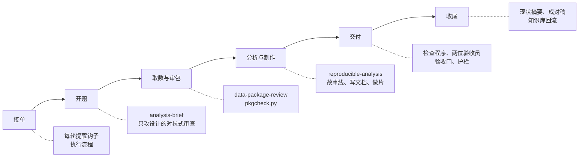

# 设计思路

这一篇讲这套工作台为什么这样设计：要解决什么问题、谁负责什么、遵守哪七条原则、由哪些部件组成，以及刻意不做什么。

**结论：** 让 AI 承担写、审、做、验里的重复劳动，但有三件事不交给 AI 的自觉：数字只能由代码算出来，标准由用户定，检查交给程序和另一个审查者。

> 下文的“用户”指使用这套工作台的分析师本人；“分析助手”是在飞书里干活的 Claude Code 助手；“取数助手”是写 SQL、跑数的一方。

## 要解决的问题

分析师的交付物最后都要给业务同事和领导看，所以“易懂、能转述、可复核”不是加分项，而是硬约束。用 AI 写分析报告以后，作者的时间主要耗在下面五处：

| 时间耗在哪 | 典型表现 | 工作台里对应的部件 |
|---|---|---|
| 改稿 | 纠正过的措辞换个说法又出现；AI 自查时越改越长 | 禁用词台账（记录用户纠正过的词和写法的表）和检查程序、修正即沉淀协议、“自查改稿只做减法” |
| 审数据包 | 说明里写着“已修复”，数据文件其实没重跑 | 审包技能 data-package-review 和体检脚本 pkgcheck.py |
| 口径返工 | 做到一半才发现分母选错、比较的两边口径不同 | 开题前先攻分析设计、项目约定页 |
| 图表返工 | 文字重叠、标签被截断、标题和图说的不是一回事 | 出图规范、出图自检 figcheck.py、图表数字验收员 |
| 等待没反馈 | 不知道 AI 在做什么、是不是卡住了 | 飞书进度卡 |

这五类是作者从自己的历史对话里数出来的，不是普遍规律；你的情况可能不同，可以按同样的办法先数一数自己的。

## 三方分工

| 角色 | 负责 | 不负责 |
|---|---|---|
| 用户（分析师） | 定要回答的业务问题和读者；在关键处拍板；手改定稿；转交需求包和数据包 | 不必盯着 AI 的每一步 |
| 分析助手（Claude Code 助手） | 接需求、写报告、做汇报片、审数据包、写需求包；交付前自检和验收；把成品发回飞书 | 不直接连生产数据；不替业务定目标；改不了自己的规则 |
| 取数助手 | 写 SQL、跑数、交数据包 | 不审自己的结果 |

取数助手可以是同一台电脑上的另一个智能体会话，也可以是一位同事。把取数和分析分开有两个好处：

- **写审分离**：写 SQL 的一方不审自己的结果，审的一方只看交来的文件和数据。
- **少拿数据**：分析助手只拿到分析用得到的字段，不需要直接连生产数据库。

“需求包”是分析助手写给取数助手的一份自足的说明：要什么字段、什么时间窗、怎么验收。“数据包”是取数助手交回来的 SQL、数据文件和说明，通常是一个 zip。

## 七条设计原则

1. **数字只能由代码和数据算出来。** 不估、不补、不拿旧值冒充新值；必须做的假设写明来源，做成外置、可调的参数。
   例：测算缺少某个比例时，先在参数区放一个假设值、标注“来源＝假设”，跑通后请业务按实际情况改，而不是在正文里写一个看起来像观测值的数。

2. **写审分离。** 写的一方不审自己的成品，验收交给只读的子代理和程序。
   例：报告写完，分析助手不自己宣布“检查过了”，而是交给两位验收员：一位以没有背景的业务同事身份冷读，一位逐张看图、回数据源核数。

3. **能程序查的，写成程序。** 规矩不靠记性。
   例：用户纠正过的词进禁用词台账，交付前 `style_lint.py` 必须 0 命中；“说改了其实没重跑”由 `pkgcheck.py` 比较文件指纹（文件的校验值，内容一变它就变）查出来。

4. **修正即沉淀。** 用户的纠正当轮记下，不等用户说“记住”；同类纠正第二次出现，写进项目约定页。
   例：用户把“断崖式下跌”改成“下降”，当轮记进台账；下次稿子里再出现，检查程序直接拦下。

5. **只做被要求的。** 默认最小交付，想扩展先问。
   例：用户只要一张汇总表，就只交这张表；顺手想到的补充分析写成一句建议，由用户决定做不做。

6. **先考试再上线。** 改技能和规则之前先量：同一份考卷，改前考一次，改后再考一次。
   例：给写作规范加一条新规则前，拿几份“交付版 → 用户定稿”让分析助手按旧规则、新规则各改一遍，比较哪一版更接近定稿。

7. **输出要好消化。** 术语表、图优先、讲清“为什么这么算”。
   例：作者回看自己说“看不懂”的那些对话，多数卡在术语、自造的概念和“为什么这么算”没讲清，嫌字多的很少。所以重点不是缩短，而是解释。

## 部件总览

| 部件 | 是什么 | 放在哪 | 详见 |
|---|---|---|---|
| 技能 | 给 Claude Code 读的说明书，按任务自动加载 | [skills/](../skills/) | [03 技能体系](03-技能体系.md) |
| 验收员 | 两个只读的子代理（Claude Code 里可以单独调用的小助手） | [agents/](../agents/) | [04 质量关](04-质量关.md) |
| 钩子 | Claude Code 在特定时刻自动运行的小程序：每轮提醒、进度卡、护栏、验收门 | [runtime/hooks/](../runtime/hooks/) | [02 运行逻辑](02-运行逻辑.md)、[04 质量关](04-质量关.md) |
| 检查程序 | 几秒钟跑完的 Python 脚本：禁用词、出图、内部痕迹、幻灯片、数据包 | 各技能目录 | [04 质量关](04-质量关.md) |
| 执行流程 | 追加进每个新会话系统提示的工作规则 | [runtime/workflow.md](../runtime/workflow.md) | [02 运行逻辑](02-运行逻辑.md) |
| 工作区约定文件 | 每个项目根目录的现状摘要、约定页、术语表、验收记录 | [templates/workspace/](../templates/workspace/) | [06 知识库怎么组织](06-知识库怎么组织.md) |
| 知识库 | 跨项目复用的口径、业务事件、指标卡 | [templates/knowledge-base/](../templates/knowledge-base/) | [06 知识库怎么组织](06-知识库怎么组织.md) |
| 考场 | 改技能前后用同一份考卷量效果的工具 | [exam/](../exam/) | [07 先考试再上线](07-先考试再上线.md) |

各部件在一条需求的哪个阶段起作用：

进度卡贯穿全程：从开工到收尾，用户在飞书里都能看到分析助手正在做哪一步、用了多久。

## 不做什么

- **不让分析助手直接连生产数据库。** 数据只来自取数助手交来的包。
- **不自动改规则。** 技能和规则的改动只出提议，由用户逐条批；运行时有护栏挡着，分析助手改不了自己的规则和设置。
- **不让模型给自己打分。** 验收交给另一个子代理和程序；考试的分数尽量用代码算。
- **不替业务定目标、不替用户做决定。** 待决定事项给建议，拍板的是人。
- **不把“同时发生”写成“原因”。** 解释波动时，对得上的业务事件只写“同期有××”，没有证据的原因写“待业务确认”。

规矩是怎么一条条加出来、又怎么防止越写越多的，见 [05 规矩怎么演进](05-规矩怎么演进.md)。每个关键设计为什么这样选、放弃了什么、代价多大，见 [09 设计取舍与替代方案](09-设计取舍与替代方案.md)。
