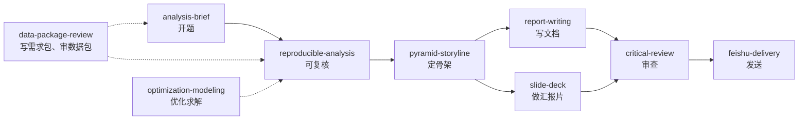

# 技能体系

这一篇讲工作台里的 11 个技能各管什么、怎么接力；再拿三个最有代表性的技能，走一遍“一次完整调用”是什么样子；最后讲怎样照模板写你自己的取数技能和口径技能。

**结论：** 技能按“开题 → 可复核 → 定骨架 → 写文档或做片 → 审查 → 发送”接力，审数据包的技能贯穿全程。公司专属的东西（取数 SQL、业务口径、PPT 母版）都写成你自己的技能，本仓库只给模板。

> **技能**（skill）是放在 `~/.claude/skills/<名字>/SKILL.md` 的一份说明书。Claude Code 根据开头 `description` 里写的“什么时候用”自动加载，也可以点名调用。技能目录里还可以放配套程序（`scripts/`）、参考文件（`references/`）和模板（`assets/`）。全部技能的一览表和依赖见 [skills/README.md](../skills/README.md)。

## 技能清单

| 技能 | 什么时候用 | 管什么 | 配套 |
|---|---|---|---|
| [analysis-brief](../skills/analysis-brief/) | 开一个新的分析、建模或测算项目 | 五要素 brief、取数前先攻分析设计、数据纪律、交付规范、收尾回流知识库 | `assets/brief-template.md` |
| [reproducible-analysis](../skills/reproducible-analysis/) | 所有分析项目，从写第一条 SQL 起 | SQL 分步带版本和口径注释；Excel 每步留公式；图能重画；交付前自检 | `assets/sql-header-template.sql` |
| [pyramid-storyline](../skills/pyramid-storyline/) | 写报告或汇报片之前定骨架 | 答案先行的金字塔；标题、章首句、图标题三种“一句话”的分工；指标波动怎么讲；会前追问清单 | `references/`（方法、实例、选图、清单） |
| [report-writing](../skills/report-writing/) | 写或改面向业务的报告、方法论、飞书文档 | 语体、数字和单位、修正即沉淀、成对稿、交付前自检 | `scripts/` 下 5 个检查程序和出图模板 |
| [slide-deck](../skills/slide-deck/) | 做正式汇报的 PPTX | 七条硬规则、配色角色、出片后逐页看图 | `scripts/check_deck.py` |
| [optimization-modeling](../skills/optimization-modeling/) | “怎么分、怎么排、怎么装才最划算” | 分配、排班、装箱的建模五步：基线、回代检查、敏感性、大白话说明 | `examples/` 两个完整走查 |
| [critical-review](../skills/critical-review/) | 重要交付物交付前 | 第一性原理拆假设，几个独立视角进攻，发现分 P1 / P2 / P3 | — |
| [data-package-review](../skills/data-package-review/) | 审取数助手交来的数据包；写需求包和取数字段清单 | 安全解包、程序体检、六个攻击点、审核报告格式 | `scripts/`（解包、体检）、`assets/`（三份模板） |
| [executive-summary](../skills/executive-summary/) | 用户明确要高管摘要、SCQA 时 | SCQA 开场和金字塔主体的补充方法 | — |
| [feishu-delivery](../skills/feishu-delivery/) | 把成品发到飞书 | 机器人身份、收件目标、文件能否打开、回执、防回环 | — |
| [workbench-maintenance](../skills/workbench-maintenance/) | 更新 Claude Code、体检、备份配置 | 更新、体检、备份三件套 | `scripts/backup.sh` |

术语：**P1 / P2 / P3** 是发现的严重程度：P1 是错误，必须修；P2 是缺陷，应该修；P3 是建议，由用户定。**回环**是指以用户身份发出的消息被桥当成新消息，助手又回复自己，循环下去。

## 技能之间的接力

- **分工写在技能里**：故事线只归 `pyramid-storyline`，用词和图表只归 `report-writing`，`slide-deck` 只管出片。一个技能不重复另一个技能的规则，只写“这件事看哪个技能”。
- **做一次、复用结果**：几个技能都要求“先亮骨架”或“审一遍”时，做一次，结果给后面的环节用。
- **只加载本轮涉及的**：讨论或发送现成的稿子时，不加载写作技能，也不顺手重做。
- `executive-summary` 只在用户明确要求时补充；`workbench-maintenance` 只管环境维护，和业务无关。

## 三次完整调用

下面三段都是虚构的，对应仓库里的示例 [续费率下滑归因](../examples/续费率下滑归因/)。

### analysis-brief：开一个新分析

**触发**：用户在群里说“续费率 W6 开始掉了 4 个点，帮我查一下原因，下周一周会要讲。”description 里的“开一个新的数据分析项目”命中，技能被加载。

**模型的前三个动作**：

1. 查知识库 `$AAW_KB`：有没有“续费率”的指标卡、业务事件日历里 W5–W6 有没有事件（查到“W6 月付涨价”）。
2. 用一句话写出理解（做什么、不做什么），只问一个会改变结论的问题：分母用到期订阅数还是活跃订阅数。
3. 写 `brief.md` 的五要素，然后叫一个子代理按 `critical-review` 的方式**只攻分析设计**，攻出“到期的人变了”（首年优惠到期潮）这条，字段清单因此一次要齐“方案”和“首次/多次续费”。

**产物**：`brief.md`、`取数字段清单.md`、`需求包_v1.md`，回复末行固定写“给取数助手：需求包_v1_…。还需要取数助手做的事：有”。

**被谁检查**：口径决定当轮写进项目 `_CONVENTIONS.md`；用户确认分母；需求包的格式由 `data-package-review` 的模板约束。

### data-package-review：审一个数据包

**触发**：用户转来取数助手的 zip，说“包回来了”。

**模型的前三个动作**：

1. `scripts/extract_package.py` 解到 `round1/pkg/`：新目录，拒绝越界路径和软链。
2. `scripts/pkgcheck.py round1 --prev <上一轮>`：比文件指纹、查公式缓存、扫明文个人信息、看时间窗缺不缺天。第 2 轮起，如果说明里写“已修复”而数据文件指纹没变，退出码 3（真实输出见示例的 [outputs/04](../examples/续费率下滑归因/outputs/04_pkgcheck_说改了没重跑.txt)）。
3. 按六个攻击点人工审，并做一次最小的独立复算（按周汇总后和核对值对账），发现核对值是按 UTC 切周的。

**产物**：`round1/审核报告_v1_….md`：复核表、本轮发现（P1/P2/P3，每条写清在什么输入下出错、重算值是多少）、发布就绪度。没有实质问题就结束，不固定轮次。

**被谁检查**：程序先查一遍能查的；“已修复”必须对上文件指纹的变化；结论级的发现先单独告诉用户。

### critical-review：交付前攻一遍

**触发**：报告写完、交付之前，不等用户开口；或者用户说“审一下”。

**模型的前三个动作**：

1. 列假设清单，每条标来源：分母口径（用户拍板）、宽限期 3 天（数据）、“W10 后首年优惠到期潮结束”（作者假设，明着给用户看）。
2. 选 3–5 个视角分别进攻：口径（时区换了没有）、逻辑（构成变化加续费率变化是否等于总变化）、业务合理性（58% 的首次续费率合理吗）、使用者（“构成变化”业务看得懂吗）。
3. 每条发现写成“在什么输入下会得出什么错误结果”，标 P1/P2/P3。

**产物**：一份审查记录：攻了哪些视角、发现了什么、修了什么、哪些 P3 留给用户。**零发现也要写清攻了哪里。**

**被谁检查**：P1、P2 修完逐条复核；之后两位验收员冷读和核数（见 [04 质量关](04-质量关.md)）。

## 自己的取数技能和口径技能

本仓库不含任何公司的取数 SQL 和业务口径，这两类要你自己写。模板在 [templates/skills/](../templates/skills/)：

| 模板 | 用途 | 章节 |
|---|---|---|
| `sql-skill-template/SKILL.md` | 一个取数主题一个技能，名字建议用 `sql-<主题>` | 速查 / 口径与踩坑（先读完再跑）/ SQL / 常见改法 / 每期刷新清单 |
| `caliber-skill-template/SKILL.md` | 一个业务口径一个技能，名字建议用 `metric-<主题>` | 速查 / 口径陷阱清单 / 各种算法的定义 / 关键连接键 / 口径改了指标跳了怎么解释 / 项目文件 / 出处 |

写的时候注意五点：

1. **description 写“什么时候用”，不写“是什么”。** Claude Code 靠它决定加载不加载。“要按周、按方案取到期订阅明细算续费率时用”比“续费率 SQL”好。
2. **口径坑放最前面。** 智能体常常一读到 SQL 就动手，坑写在后面等于没写。典型的坑（虚构）：扣款流水记 UTC、订阅表记本地时间，直接按天汇总，零点前后 8 小时的记录会落到另一天。
3. **SQL 带口径注释块**：用途、一行是什么、时间口径和时区、过滤和剔除的理由、对应哪张 Excel 表，格式照 `reproducible-analysis`。代码说明怎么算，注释说明为什么这么算，后者才是被审的对象。
4. **已知有错的旧写法要在开头标明**，例如“连接键以某口径技能为准，本技能里的旧写法要先改”。不要让新旧两套并存而不说明。
5. **例子用虚构的表名和数字**；真实的放在你本机的技能里，不要提交到公开仓库。

## 技能写法守则

- **正文只写规则。** 不写日期、项目名、业务数字，也不写“某次发生了什么”这类事故经过；出处另放归档或索引表。
- **一个技能管一件事**，和其他技能的分工写清楚。
- **主文件短，细节放 `references/`**，并在主文件里写一句“什么时候读哪个”。技能每次触发都要整篇读入，主文件越长，越容易被忽略。
- **只引用自己目录里的文件**，或兄弟技能；提到仓库别处时写明“仓库”。用户可能只复制了 `skills/`。`tools/check_repo.py` 会查这一条。
- **设总字数上限**，按去掉空白后的字数算，不按行数（只限行数时，智能体会把内容塞进超长的单行）。当轮记纠正不受上限阻挡，超了留到下一次大扫除。
- **作废的挪去归档**，注明作废日期和由哪条取代，不直接删。
- **技能里的数字只是示例**，给管理层的材料不照搬。
- **能写成程序的写成程序**，放在 `scripts/`；正文写清怎么跑、退出码是什么意思。

规矩怎么加、怎么减，见 [05 规矩怎么演进](05-规矩怎么演进.md)。

## 依赖的第三方技能

- **飞书操作**（发消息、读写飞书文档）用飞书官方的 lark-* 技能和 lark-cli；只在终端用时不需要。
- **处理 docx、xlsx、pptx、pdf** 可以配 Anthropic 官方技能（许可不允许再分发，请自行安装）。

链接见 [ACKNOWLEDGEMENTS.md](../ACKNOWLEDGEMENTS.md)，安装办法见 [08 安装与配置](08-安装与配置.md)。
