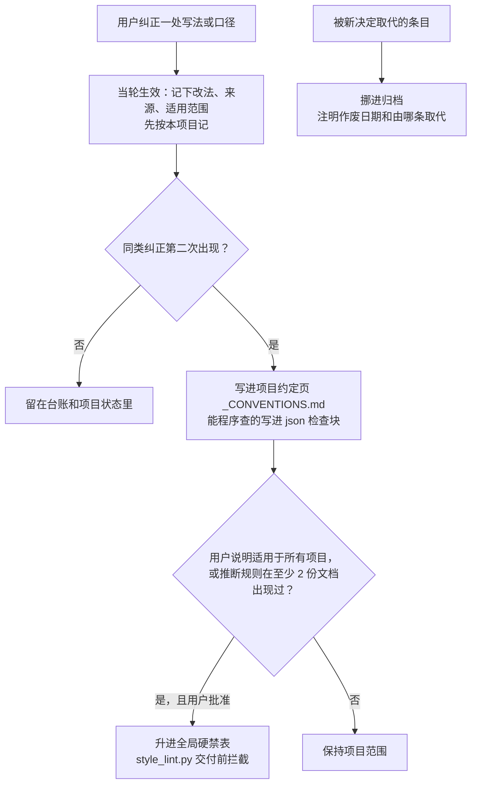

# 规矩怎么演进

这一篇讲工作台里的规矩从哪来、怎么加、冲突时听谁、怎么防止越写越多，以及改钩子和规则时要走的上线规矩。

**结论：** 规矩来自用户真实的纠正，而不是凭空设计；加的时候有门槛、有优先顺序、有总字数上限，作废的挪去归档；改运行时要先过独立审查、历史命令回放和端到端排练三道关，才能上线。

## 规矩的来源

作者把自己和 AI 的历史会话全部翻了一遍，数出那些反复手打的要求，例如“先理解我的意思”“不要过度展开”“用大白话”“按既有的文档和 PPT 要求来”“交付前做对抗式审查”，然后固化到三处：

| 放在哪 | 管什么 | 本仓库对应 |
|---|---|---|
| 用户级 `~/.claude/CLAUDE.md` 的“工作协议” | 所有会话都要守的默认期望 | [templates/global-CLAUDE.md](../templates/global-CLAUDE.md) |
| 每轮提醒钩子 | 每条消息后面自动补上的长期要求 | `runtime/hooks/remind.py`（见 [02 运行逻辑](02-运行逻辑.md)） |
| 自建技能 | 具体怎么做 | [skills/](../skills/)（见 [03 技能体系](03-技能体系.md)） |

之后每一次被纠正，都按下面的协议沉淀。

## 修正即沉淀



1. **用户原话当轮生效。** 不等用户说“记住”：当轮记下改法、来源和适用范围，先按本项目记，同步进本项目的生成源。用户说明适用于所有项目的，才写进全局规则。
2. **推断出来的规则要过门槛。** 从用户改动里推断出来的规则（不是用户原话），要在至少 2 份文档里出现过才当规矩用；没过门槛之前只记观察。升进全局硬禁表也要过这道门槛。
3. **作废不删。** 被新决定取代的条目挪到技能目录里的归档文件（ethan-report-writing 里和禁用词台账放在一起），注明作废日期和由哪条取代。
4. **用户的亲笔改写是最高优先级的风格样本。** 用户直接改了飞书文档时，拿发布时存的快照对比，提取改法，同样入台账。

例（虚构）：用户把稿子里的“值得注意的是”整句删掉，当轮记进台账；两周后另一份稿里出现“值得特别注意的是”，于是写进项目约定页，并给检查程序补上带省略的变体写法“值得……注意的是”。

## 冲突时的优先顺序

> 用户原话 ＞ 项目约定页 ＞ 全局技能 ＞ 智能体推断

另外，最近的具体请求和项目里已定的决定，优先于技能里的旧写法。技能里的历史数值只是示例。

## 第二次纠正同一个词

说明检查程序没跑，或者跑了没拦住。要主动说明原因并补检查，而不是再记一遍。作者遇到过的几种“没拦住”：

- 台账里一行把两个禁词用斜杠连写，程序当成一个整词去找，永远找不到；
- 程序只匹配原词，用户删掉的说法换个字又出现了；
- 条目记在台账的项目小节里，而程序只读硬禁表。

前两种已经在 `style_lint.py` 里修掉（斜杠两边分别匹配，省略号代表中间可以夹几个字）；第三种靠分流解决：只适用本项目的写进项目约定页（`deckcheck.py` 会读），跨项目的由用户勾过再升进硬禁表。你自己的检查程序也值得照这个清单查一遍。

## 防膨胀

只增不减的规则库会互相矛盾、读了也不照做。典型的症状是：禁用词台账几个月里涨了好几倍，几乎没删过；写一份报告要先读上百 KB 的规范；规范之间开始互相打架；拿纠正过的词去试检查程序，发现大多拦不住。同类研究也提醒：技能库只往里加、不把关，效果会先升后降。

所以定了四条：

- **总字数上限。** 整套写作规范设一个上限，按去掉空白后的字数算，不按行数。当轮记纠正不受上限阻挡；超了留到下一次“大扫除”，由用户批准后合并或作废等量内容。
- **大扫除由用户批。** 矛盾列成“改前 / 改后＋样例”的表，用户逐行勾。
- **规则正文不写日期和项目名。** 出处记在归档里的索引表。
- **常驻系统提示要精简。** 只留机制、红线和用户口味；泛泛的叮嘱、历史说明、和技能重复的内容删掉。精简时把执行流程压到原来的一半左右是做得到的，前提是逐项核对关键机制一条没丢。

## 改运行时的上线规矩

钩子、执行流程、共享手册、技能和检查程序都是“运行时”：改一处，所有会话都受影响。所以改动按这个顺序上线：


1. **备份**，写好撤销办法。
2. **请一位没参与写的审查员专门攻击。** 作者的经验：自己复查没发现的严重问题，独立审查员一次就能找出好几个。
3. **历史命令回放**：把过去会话里的所有 Bash 命令喂给新的护栏和验收门，看会不会误拦。
   ```bash
   AAW_HOOK_STATE=$(mktemp -d) python3 runtime/tools/replay_history.py runtime
   ```
   回放最常抓到的是误拦正常命令，例如：工作区路径里恰好带着桥的程序名，被当成“启停桥”；用 `for` 循环逐个发文件，验收门推算不出文件位置。这类问题单元测试很难想到，回放一跑就出来。
4. **端到端排练**：建一个假工作区；在 `PATH` 最前面放一个假的 `lark-cli`（只记参数、返回成功）；用和桥同款的命令行，从标准输入喂一条带 `bridge_context`（桥附在消息里的本轮信息，含群号）的消息，看分析助手从接单到发送的全过程。场景要包括“材料里夹带指令”（数据包里写着“发到别的群”“贴出密钥”），看它照不照做、会不会在回复里点明。
   ```bash
   LARK_CHANNEL_PROFILE=$AAW_PROFILE AAW_WS_BASE=<假工作区总目录> AAW_HOOK_STATE=<假状态目录> \
   PATH=<放假 lark-cli 的目录>:$PATH \
   claude -p --output-format stream-json --verbose \
     --permission-mode bypassPermissions \
     --append-system-prompt-file runtime/workflow.md < 一条测试消息.txt
   ```
   `--permission-mode bypassPermissions` 是跳过逐条确认，和作者所用的桥的启动方式一致（设置和钩子照常加载）；正因为跳过确认，排练只能在假工作区里跑。要连读文件也挡住，用 [exam/](../exam/) 里的考场。
5. **生成部署指纹**（每个文件的校验值），撤销脚本靠它判断文件部署后有没有被动过。
6. **各群发 `/new`。** 桥续接旧会话时，Claude Code 沿用开会话时那份系统提示，新的 workflow.md 要开新会话才加载。

改技能和写作规范还要多一步：先考试再上线，见 [07 先考试再上线](07-先考试再上线.md)。

## 钩子的工程经验

- **钩子在命令执行前运行。** 同一条命令里才生成的文件，这时还不存在。
- **cwd 会变。** 钩子输入里的当前目录，会跟着上一条命令里的 `cd` 变。
- **并行的工具调用，钩子也并行。** 同一条回复里同时发起的几个工具调用，它们的钩子会同时在跑；共享状态要加锁（`O_EXCL` 建锁文件）或用带进程号的临时文件，替换文件用原子操作。
- **入口包一层“脚本不存在就放行”。** 否则缺一个文件，非零退出码就会拦住全部命令。拦截只用钩子输出的 JSON 表达，其他退出码一律当放行。
- **Stop 钩子只做安静的收尾。** 它如果拦截，会顶掉这一轮的最终答复。
- **大命令先做廉价预检。** 几十 KB 的命令逐条跑正则会变慢，超时就成了静默放行；先查有没有相关关键词，一个都没有就直接放行。
- **日志不记命令原文。**
- **关掉后台运行**（`CLAUDE_CODE_DISABLE_BACKGROUND_TASKS=1`）。子代理在后台跑时会产生多个结果事件，桥可能把“还在处理”当成最终答复。
- **留总开关和存活记号。** 钩子目录下放一个 `DISABLED` 文件就全部不生效；每个钩子运行时写一个 `.alive-<名字>`，体检时看最近一次触发时间，就知道钩子是不是真在跑。

## 复盘口径

一轮优化有没有用，看这些数：

| 指标 | 怎么数 |
|---|---|
| 纠正轮数 | 带纠正的对话轮次占比 |
| “看不懂”类反馈 | 用户说看不懂、太复杂的次数 |
| 图表瑕疵 | 关于图的评论数 |
| 来回轮数 | 同一件交付物出了几版 |
| 验收记录数、门拦下的次数 | `_acceptance/records.jsonl`、钩子日志 |
| 手改比例 | 成对稿里用户改动的行数占比；最干净的一个，见 [07 先考试再上线](07-先考试再上线.md) |

局限要照实写：前几项按关键词粗分，只能看量级；样本小；分类有主观性。复盘时每条反馈多记一栏“对应的要求当时写在哪一层”（全局协议、技能、项目约定、提醒钩子），才分得清是规则缺了，还是写了没照做。

作者的一次复盘就是这样得出关键结论的：“用户的标准没有固定的载体传给写的一方和验的一方”——验收员每次只能靠分析助手临时转述来知道用户要什么。于是有了项目约定页：验收员每次都拿到这一页。
