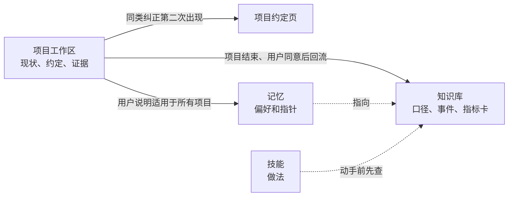

# 知识库怎么组织

这一篇讲工作台里的信息分几层放、知识库里有哪些文件、每个项目工作区里有哪些约定文件，以及什么时候把项目里学到的东西写回知识库。

**结论：** 按“谁读、多久变一次、能不能跨项目共享”分四层：知识库放可复用的口径和来源，记忆放偏好和指针，技能放做法，审核证据和版本历史留在项目里。项目结束时先问用户，再把项目里查清的口径和事件回流知识库。

## 分层

| 层 | 放什么 | 谁读 | 多久变一次 | 例子（虚构） |
|---|---|---|---|---|
| 知识库 | 可复用的业务口径、业务事件、指标定义和出处 | 所有项目 | 口径变了才改 | 指标卡“续费率”的分子和分母 |
| 记忆 | 用户偏好，以及指向详细文件的指针 | 每个会话自动加载（有长度上限） | 偶尔 | “报告第一部分只写结论”；“某项目详情见某文件” |
| 技能 | 做法：怎么写、怎么审、怎么检查 | 按任务加载 | 很少，改要走上线规矩 | report-writing |
| 项目 | 现状、约定、审核证据、版本历史 | 本项目 | 天天变 | `_status.md`、审核报告 |

为什么要分开：混在一起会出两种问题。一是记忆里塞进项目细节，每个会话都要加载，越来越长、越来越慢；二是项目里查清的口径没回流，下一个项目又踩一遍同样的坑。



## 知识库里的文件

模板在 [templates/knowledge-base/](../templates/knowledge-base/)，复制到你自己的知识库目录（环境变量 `AAW_KB`，默认 `~/aaw-kb`）后填内容。

| 文件 | 作用 | 固定的表头或章节 |
|---|---|---|
| `README.md` | 说明知识库放什么、不放什么 | — |
| `项目索引.md` | 做过哪些项目，一行一个 | 项目 / 要回答的问题 / 方法要点 / 关键结论或数字（有出处才写）/ 成品和位置 / 踩过的口径坑 / 状态和最后活动日期 |
| `业务事件日历.md` | 促销、调价、版本上线、系统切换、节假日这类带日期的事件 | 日期或周 / 业务线和对象 / 事件 / 当时的影响（有数据才写）/ 出处；另有周次对照表和事件类型标签【业务】【系统】【口径】 |
| `指标卡/` | 一个指标一张卡 | 一句话定义 / 分子 / 分母 / 最近的数（带适用周次）/ 数据从哪来 / 周会口径和明细口径的差别 / 常见的坑 / 第一次出现时怎么跟领导解释 / 相关文件 |
| `口径文档_模板.md` | 一事一文件的口径说明 | 文件名带日期；开头写依据和适用范围 |
| `项目收尾清单.md` | 项目结束时要交代的八项 | 见下文“写回时机” |

三条共同的规矩：

- **查不到的写“—”或“待确认”，不要自己补。** 知识库里的每个数都要能指回出处。
- **每个文件头部写依据和适用范围**，例如“数字适用 W1–W8”。
- **可复核性总纲**直接用 [skills/reproducible-analysis](../skills/reproducible-analysis/)，不在知识库里另存一份，免得两份副本不一致。

## 业务事件日历的用法

1. 解释指标波动之前，先按日期或周次查，有没有对得上的事件。
2. 对得上，只写“同期有××（日期）”，不写成原因。“同期发生”只是日期重叠；“记录里写明的影响”才是有数据的结论，两种说法不混用。
3. 对不上，写“待业务确认”，不自己编原因。
4. 新查清的事件补进来：日期、业务线和对象、事件、影响、出处，五样都写。
5. 周编号不止一套时（自然周、周会用的周），先问清用的是哪一套。

例（本例事件均为虚构；“当时的影响”一栏记录里没有数，所以写“—”）：

| 日期或周 | 业务线和对象 | 事件 | 当时的影响 | 出处 |
|---|---|---|---|---|
| W5 第 5 天 | 月付方案 | 【业务】发出涨价通知 | — | 运营周报 W5 |
| W6 第 1 天 | 月付方案 | 【业务】月付价格从 18 元调到 22 元 | — | 定价变更记录 |
| W6–W8 | 年付方案 | 【业务】去年首年优惠买的年付订阅集中到期 | — | 活动排期表 |

于是报告里写“续费率 W6 起下降，同期有月付涨价（W6）”，而不是“因为涨了价”。原因要另找证据：比如没涨价的年付续费率有没有变（见示例 [续费率下滑归因](../examples/续费率下滑归因/)）。

## 工作区约定文件

每个项目工作区的根目录放下面几样，模板在 [templates/workspace/](../templates/workspace/)，完整的虚构示例在 [examples/续费率下滑归因/](../examples/续费率下滑归因/)。

| 文件 | 作用 | 谁写 | 谁读 |
|---|---|---|---|
| `_status.md` | 顶部是现状摘要，下面是历史记录 | 分析助手，每轮有实质进展时更新 | 新会话预览（`status_preview.py`）；每轮提醒钩子查它的长度 |
| `_CONVENTIONS.md` | 项目约定页：讲给谁、讲什么；口径；页面上不出现的；写法；末尾一个 json 检查块 | 同类纠正第二次出现时写 | `deckcheck.py`、图表数字验收员 |
| `_glossary.md` | 术语表，10 到 20 个词：统一写法 / 含义（第一次出现时这样解释）/ 不要写成 | 分析助手起草，用户过目 | 分析助手、读者验收员 |
| `_acceptance/records.jsonl` | 验收记录 | `accept_record.py` | 验收门 `gate.py` |
| `_doc_assets/` | 发布过的飞书文档的正文快照 | 分析助手，发布或大改后 | 用户说“看我改了哪里”时拿来对比 |

**现状摘要**是新会话接续的首选依据，写在 `_status.md` 顶部的标记块里：

```markdown
<!-- 现状摘要:开始 -->
## 现状摘要（更新于 2026-01-01 17:00）
- 当前在做：……
- 下一步：……
- 仍然有效的限制：……
- 最近的决定：……
- 在等谁：……
- 当前有效成品和链接：……
- 给取数助手的交接：……
<!-- 现状摘要:结束 -->
```

顺序固定，不超过 5,000 字（新会话预览只显示这么多）；页码对照表、生成命令这类细节放单独文件，摘要里只写路径。历史追加在标记块下面，不再叠加新的“当前”“最新”标题。

**项目约定页的 json 检查块**让纠正变成程序能查的规则。键的含义：

| 键 | 含义 | 例子（虚构） |
|---|---|---|
| `banned` | 页面上不用的词，以及该换成什么、为什么 | `[{"word": "续订", "use": "续费"}]` |
| `display_names` | 系统原名 → 页面上的展示名 | `{"voluntary_cancel": "主动取消"}` |
| `codes` | 对象名 → 编号，设了才查“名字前漏了编号”（项目需要这条规矩时才设） | `{"甲店": "1001"}` |
| `terms` | 本项目的专有词，导出 PDF 后不许被拆在两行 | `["续费率", "首次续费"]` |
| `variants` | 同一个东西的几种写法，全片只许用一种 | `{"自营渠道": ["自营", "直营"]}` |
| `allow` | 被误报的合法长词 | `["首次续费率"]` |

几条项目目录的约定：

- 交付物版本化命名，不覆盖旧版。
- 审核类工作一轮一个子目录。
- 分析代码（SQL、出图脚本）随项目归档。
- 用户发来的附件立即复制进项目目录，改成可读的名字。
- 已有的同名约定文件如果写明“只有用户能改”，不往里写，把纠正列给用户定。

## 写回时机

- **用户说“记住”就是落盘**：写进文件，不只留在对话上下文里。
- **同类纠正第二次出现**，写进项目约定页（见 [05 规矩怎么演进](05-规矩怎么演进.md)）。
- **项目结束时先问、再回流**，用户同意后做三步：
  1. 项目约定页里的口径和关键决定，并进知识库对应的口径文档或指标卡；
  2. 项目索引补一行，或更新状态；
  3. 业务事件日历补上这次查清的事件。
- **项目收尾清单**的八项：项目名与结论、产出清单、假设表、口径变更记录、审查记录、轮次统计、建议归档位置、未做事项。
- **不自行改技能**：反复出现的做法列给用户，由用户决定要不要写进技能。

## 交付物里的三样记录

| 记录 | 写什么 |
|---|---|
| 假设表 | 每个假设的值、来源（数据 / 用户拍板 / 假设）、影响哪些结论、怎么改 |
| 审查记录 | 审了哪些视角、发现了什么、修了什么、留给用户定的是什么 |
| 口径变更记录 | 哪天、哪个口径、从什么改成什么、为什么、影响哪些数 |

稿子重写或压缩之后，回原稿核对两样：**数字**和**限定语**（“约”“以内”“仅指”这类词）。压缩时最容易悄悄丢掉的就是它们。

## 记忆索引的写法

Claude Code 的记忆索引 `MEMORY.md` 每次会话都会加载，而且有长度上限，超出的部分会被截掉。所以：

- 一行一条，只放指针：标题、链接到详细文件、一句话说明；详细内容放在单独的文件里；
- 必读的条目用星号标出；
- 项目事实留在项目里，只有用户明确说适用于所有项目的偏好才进共享记忆；
- 工作群里不主动提及个人类的记忆。

样例见 [templates/memory/MEMORY.md](../templates/memory/MEMORY.md)。
