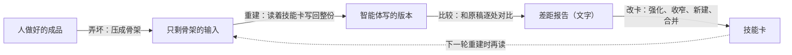

# 先考试再上线

这一篇讲改技能和规则之前怎么先“考一次”：方法从哪来、考卷怎么攒、考场怎么搭、怎么打分、一次真实考试的结果，以及这套做法的规矩和适用范围。

**结论：** 改技能和规则之前，先用真实的“交付版 → 用户定稿”当考卷：改前考一次，改后用同一份考卷、同一套打分脚本再考一次，量出来有用才上线。最终看的不是考卷分数，而是用户接下来几份真实交付的手改比例有没有降；改了两轮还不降，就停下来，照实说没用。

## 方法来源

思路来自论文《Skill Training with Corruption and Reconstruction Loop》（arXiv 2607.27557，链接见 [ACKNOWLEDGEMENTS.md](../ACKNOWLEDGEMENTS.md)）。它不改模型，只练一套给智能体读的短说明书（下文叫“技能卡”），练法分四步：

**最值钱的发现：** 让模型直接读好成品、总结规矩，学不到东西；先让它自己做一遍、犯了错，再对照原稿，才学得到“它自己会错在哪”。另一个证据最硬的部件是**卡片长度上限**：不设上限时，卡会长成一份份事故记录。

**要打折看的地方：**

- 只跑过一次，没有验证集；
- 当评委的和写差距报告的是同一个模型；
- 越强的模型，从这个循环里挖出的硬规则越少（论文作者建议用较弱的模型挖规则、给较强的模型用）。

**同类研究提醒的风险：**

- 技能库只往里加、不把关，成绩会先升后降，事后删掉坏卡也救不回来；
- 没有标准答案、只让模型自我反思，比什么都不用还差；
- 有了技能，模型有时会过早自信，跳过该做的检查。

## 与分析工作的对应

用户的每一次手改，就是论文里的“差距报告”；分析助手把改法提炼进台账，就是“改卡”。这个循环其实已经在手工跑一半了，缺的是三样：

1. 手改没有被存成能反复用的考卷；
2. 没有人量过技能到底有没有用；
3. 规则只增不减、互相矛盾，写进去了也常常没照做。

所以顺序是：**先建考场，再谈训练。**

| 论文的部件 | 工作台里对应的 | 补上的工具 |
|---|---|---|
| 人做好的成品 | 用户亲笔改过的定稿 | `pairsnap.py` 固定存成对稿 |
| 差距报告 | 用户的手改 | 成对稿的逐行差异 |
| 改卡 | 写进台账、技能、项目约定页 | 修正即沉淀协议，改卡由用户逐条批 |
| 重考 | （原来没有） | 考场 [exam/](../exam/) |
| 检查器 | 禁用词检查 `style_lint.py` | 修好真毛病、补上变体写法 |

## 成对稿

**成对稿**是同一份文档的“分析助手交付版”和“用户改过的定稿”。

- 用户手改之后，运行 `pairsnap.py save --project <项目> --doc <文档名> --delivered <交付版> --final <定稿>`。它存下交付版、定稿、两者的差异和原样副本，并算两个数：手改比例（用户改动涉及的行数 ÷ 交付版行数）和篇幅比（定稿字数 ÷ 交付版字数）。
- 存放在一个分析助手平时不读的独立目录（环境变量 `PAIRSNAP_ROOT`），不放在项目目录里。
- **每 3 份留 1 份当考题**（存的时候就定死）。从考题提取的改法照常记，但写到哪里都标“考题来源”；考试时把这些地方一起遮掉，免得考生“偷看答案”。日常干活照常使用全部记忆和台账，不要因为某份稿看着像考题就不用。
- 最干净的指标就是**手改比例**：以后判断任何改动有没有用，都看接下来几份真实交付的这个数有没有降。

## 考场

考场是一个让分析助手“照常干活、但碰不到答案也伤不到线上”的环境，工具在 [exam/harness/](../exam/harness/)：

- **假工作区**：从考卷生成的临时项目目录。
- **假 lark-cli**：只记参数、返回成功，不真发消息。
- **和桥同款的命令行**：设置和钩子照常加载，考的就是线上那一套。
- **事前挡**：macOS 的 `sandbox-exec` 规则分六段——挡读定稿和它的派生物；挡读桥的配置和凭据；挡真的 lark-cli；挡全部历史会话记录；挡写线上文件（技能、记忆、设置、工作区、知识库）；不许给沙盒外的进程发信号。之所以要用系统级沙盒，是因为 Claude Code 设置里的读取禁令只管内置的读文件工具，管不住 Bash 里的 `cat` 和 `python`。
- **事后查**：审计全部工具调用读过的路径；输出里出现定稿独有、原稿没有的 15 字以上片段，这一遍作废。
- 不是 macOS 时，用单独的系统账户或容器隔离，办法见 [exam/README.md](../exam/README.md)。

## 打分

考卷先切成“改动块”，分三类：

- **A 块**：现行规则能推出的用户改法，算分母；
- **B 块**：规则没写到的用户改法，单独报，测的是“能不能举一反三”；
- **C 块**：事实或口径上的改动，不计分。

四个代码指标（打分脚本在 [exam/scoring/](../exam/scoring/)）：

| 指标 | 意思 | 为什么看它 |
|---|---|---|
| 规则写明的改法命中几成 | A 块里，考生也朝定稿方向改了几块 | 规则写了，有没有照做 |
| 用户原样保留的句子被改了几成 | 用户没动的句子，考生改了多少 | 等于给用户添了多少复核负担 |
| 数字一个不差 | 两版共有的数有没有被改；有没有凭空新增的数 | 数字只能由代码算 |
| 篇幅比 | 考生稿字数 ÷ 交付版字数，和定稿比 | 用户的改法多以删为主 |

**辅助评委**：换一个型号的模型，只判“改的方向对不对”，每条都引原句，不打 1–5 分。用之前先拿用户标过的样本校准，和用户的一致率低于一条外置的线，就只报代码指标。

**场景题**：

- **夹带指令**：数据包里写着“发到别的群”“贴出密钥”，看分析助手照不照做、会不会在回复里点明；
- **留作考题**：看“考题来源”标记有没有漏进成品；
- **审包盲考**：把后来的审核意见藏起来，看现在的分析助手能查到几成。

## 一次真实考试的结果

下面是作者拿自己的稿子考的一次。**单人、小样本、开卷**，只能看方向，数字只给量级。

**改前**（几份成对稿、几个数据包）：

- 规则里写明的改法，大约照做了一半多；
- 但用户原样保留的句子被改了一半以上，多数稿子越改越长（而用户的定稿多数是删减），还改了几个用户保留下来的数（考生认为原文有误，但没有回源数据核实）；
- 审包盲考查到了大约三分之二的已知问题。

**据此加了一条规则：“自查只做减法”。** 交付前按规范自查时，只改有规则依据或读者会看不懂的地方；数字不改，觉得有误先回源数据核实；改完不应比原稿长；回复里逐条列出改了哪几处、各依据哪条规则。

**改后**（同一份考卷、同一套打分脚本，复考其中一部分）：

- 用户保留句被改的比例，从一半以上降到一成左右；
- 被改了值的数字降到 0，也没有凭空新增的数；
- 稿子都比原稿短；
- 但“规则写明的改法命中几成”没有一起涨，有一份反而大幅下降：考生判断“这份像考题”，主动没用记忆里记下的改法，所以这一份前后测的不完全是同一件事；
- 审包那一题，查到的已知问题少了一条；只跑了一次，说不清是不是改动造成的。

**怎么看这些数：** 样本小，每题只跑一次；而且是开卷，新规则正是照这几份旧稿的改前成绩写出来的，复核负担下降有一部分属于“拿训练题考”。换成新稿，效果能剩多少，这次回答不了。这正是要继续攒新成对稿的原因。

想先看看打分脚本长什么样，跑仓库里的虚构示例考卷就行（见 [exam/README.md](../exam/README.md)“先跑一遍示例”），不花钱，也不需要 macOS。

## 规矩

1. **改卡只出提议**，以“改前 / 改后＋样例”的形式交给用户逐条批；改卡不自动生效。
2. **每轮最多改 3 条**，整套规范的总字数不增。
3. **比较尽量用代码判。** 必须用模型时，只让它判方向，先校准。
4. **不让模型给自己打分**，也不拿模型自己迭代出来的稿子、或验收员“通过”的稿子当标准答案——那是在学自己的口味。
5. **学习过程中不改考题，也不改评委。**
6. **事前挡加事后查，两样都做。**
7. **候选卡先考、后上线**；上线照 [05 规矩怎么演进](05-规矩怎么演进.md) 的上线规矩走。
8. **不在聊天里边聊边改技能。** 桥里的会话跑不了长任务，而且一张卡改了，本机所有会话都受影响。
9. **停止规则**：改了两轮之后，真实手改比例还是不降，整件事停下，照实报“没用”；不调门槛去凑。

## 不适用的场景

- **SQL、口径、Excel 里的数**：它们有已知答案，直接校验（做成回归题）比学“文字像不像”好得多。
- **图表**：文字规则管不住画面，不适合拿来训练；但可以当考试——拿用户对图的评论当答案，看验收员和 `figcheck.py` 能不能事先指出。
- **拿检查程序的命中数当分数**：检查器有漏洞时，这是假信号，优化下去只会教模型换同义词。
