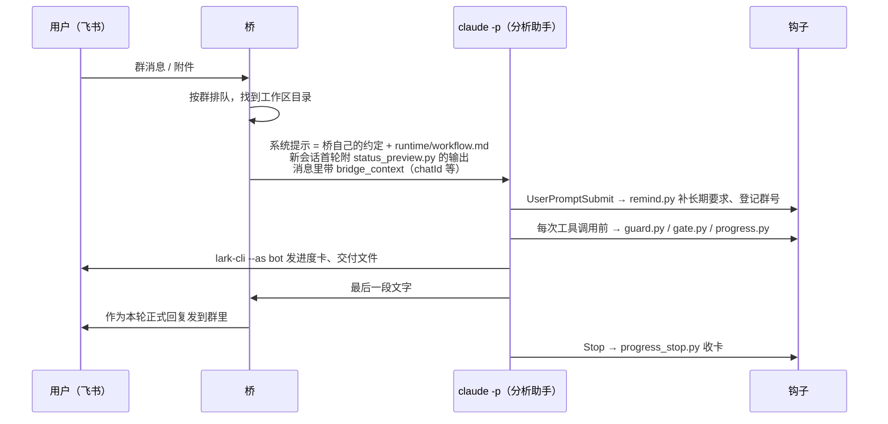

# 接入飞书桥

分析助手本身只是“Claude Code + 这个目录里的规则和钩子”。把它放进飞书群，需要一个**桥**：一个常驻程序，收到飞书消息后，按群找到对应的工作区，在那里启动 `claude -p`，再把回复发回群里。本仓库不含桥的代码；作者用的是开源的 lark-channel-bridge（链接见 `ACKNOWLEDGEMENTS.md`），你也可以换成任何能做到下面四件事的桥，或者自己写一个。

## 一条消息怎么走

## 桥要提供的四项能力

| # | 能力 | 分析助手靠它做什么 | 不提供会怎样 |
|---|---|---|---|
| 1 | 把 `runtime/workflow.md` 追加进每个新会话的系统提示（Claude Code 的 `--append-system-prompt-file`） | 执行流程、验收规矩、给取数助手的需求格式 | 规则不注入，分析助手按默认习惯做事 |
| 2 | 新会话第一轮运行 `python3 runtime/status_preview.py <工作区>`，把输出拼进提示 | `/new` 之后接上项目进度 | 每次 `/new` 都要用户重讲一遍背景 |
| 3 | 在消息里给出 `bridge_context`，至少带本轮的 `chatId`（形如 `"chatId":"oc_…"` 的 JSON） | 进度卡、发送都发回本群；护栏据此判断“发到别的群” | 进度卡起不来；“发到别处”这条护栏失效 |
| 4 | 启动 `claude -p` 时带环境变量 `LARK_CHANNEL_PROFILE=<你的 profile 名>`，并让 `AAW_*` 变量传下去 | 钩子据此认出“这是分析助手”，只在桥里生效 | 钩子全部不生效（`doctor.sh` 会显示“没有记录”） |

可选的第五项：**阶段检查命令**。桥在 `bridge_instructions` 里给一条只读命令，分析助手在批量写入、发送前先跑它；用户在分析助手干活时又发了新消息，命令返回 `yield`，分析助手就把现状写进 `_status.md` 结束这一轮，桥接着处理新消息。没有它也能用，只是用户中途改主意时分析助手要等这一轮做完才看得到。

## 可替换的地方

- **桥的程序名**：护栏会拦“启停或杀掉桥”。默认认 `lark-channel-bridge`，换了桥就设 `AAW_BRIDGE_NAMES`。
- **桥的密钥文件名**：`hooks/guard.py` 文件头的 `SECRET_TOOLS`、`SECRET_FILE_NAMES` 两个常量，换成你的桥实际用的。
- **桥的主目录和配置文件**：设 `AAW_BRIDGE_HOME`、`AAW_BRIDGE_CONFIG` 后，护栏和工作区写入门槛会保护它们。
- **发消息的命令**：进度卡和交付都用飞书官方的 `lark-cli`，并且一律 `--as bot`。不用飞书时，把 `bin/card.py` 里的 `api()` 换成你那边的发送方式，护栏里 `SEND` 正则换成对应命令。
- **群号格式**：护栏只在群号以 `oc_` 开头时判断“别的群”。别的平台改 `turn_chat()` 和 `remind.py` 里取 chatId 的正则。

## 三个坑

1. **机器人发的消息被当成用户消息**：发送不带 `--as bot`，桥会把它当成新消息再交给分析助手，形成死循环。护栏专门拦这一条。
2. **每一轮必须以文字收尾**：桥通常只把“最后一段文字”当正式回复。只有工具调用没有文字，群里就什么也收不到。
3. **后台任务会被当成“已经答完”**：回合结束桥会结束整棵进程树。`workspace_settings.py` 写入 `CLAUDE_CODE_DISABLE_BACKGROUND_TASKS=1`，让命令和子代理都在前台跑完。
